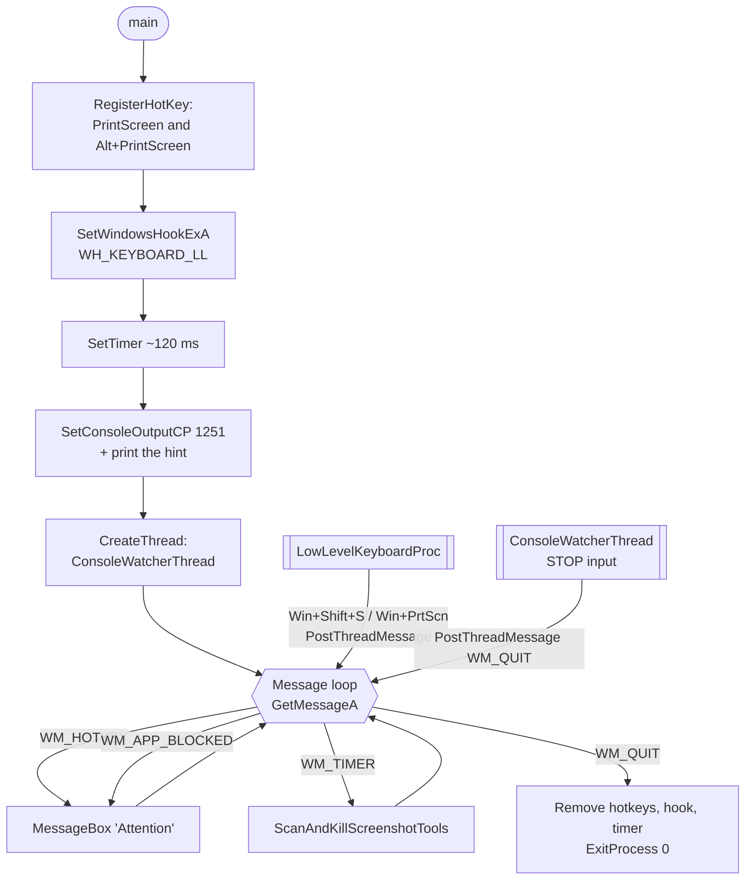

<div align="center">

**English** | [Русский](README.ru.md)

# 🛡️ BlockScreenshot Win64

**An x64 assembly programme that blocks the built-in Windows screenshot methods while it is running**


-blueviolet)


</div>

---

## 📑 Contents

- [About](#-about)
- [What gets blocked](#-what-gets-blocked)
- [Platform and technical requirements](#-platform-and-technical-requirements)
- [Building and linking (NASM + GoLink)](#-building-and-linking-nasm--golink)
- [Running and exiting](#-running-and-exiting)
- [How it works](#-how-it-works)
- [Configuration](#-configuration)
- [Limitations](#-limitations)
- [Troubleshooting](#-troubleshooting)

---

## 📖 About

**BlockScreenshot Win64** is a console utility written entirely in assembly (NASM, Intel syntax) for 64-bit Windows. While it is running, it intercepts the standard ways of taking a screenshot and shows the user a warning instead.

The programme uses no C runtime and no third-party libraries: everything is implemented with direct WinAPI calls from `kernel32.dll` and `user32.dll`. No administrator rights and no drivers are needed.

The protection has six layers: two key-interception mechanisms (hotkeys and a low-level hook), plus background termination of screenshot tools that were launched without the keyboard.

---

## 🎯 What gets blocked

| # | Screenshot method | Intercepted by |
|:-:|---|---|
| 1 | `PrintScreen` | `RegisterHotKey` |
| 2 | `Alt` + `PrintScreen` | `RegisterHotKey` |
| 3 | `Win` + `Shift` + `S` (Snipping Tool) | low-level keyboard hook |
| 4 | `Win` + `PrintScreen` (save to file) | low-level keyboard hook |
| 5 | `Win` + `Alt` + `PrintScreen` | low-level keyboard hook (checks that `Win` is held) |
| 6 | Snipping Tool / Screen Sketch launched **without keys** (icon, Start menu, etc.) | process-list polling every ~120 ms plus `TerminateProcess` |

Whenever any layer triggers, a system warning window with the title "Внимание" ("Attention") is shown.

---

## 📂 Repository structure

```
BlockScreenshot/
├── BlockScreenshot_Win64.asm   # the entire source code
└── README.md
```

---

## 💻 Platform and technical requirements

| Parameter | Value |
|---|---|
| **OS** | Windows 10 / 11, 64-bit |
| **Architecture** | x86-64 |
| **Calling convention** | Microsoft x64 ABI (`rcx`, `rdx`, `r8`, `r9` + 32 bytes of shadow space; stack aligned to 16 bytes) |
| **Application type** | Console (`/console`) |
| **Assembler** | [NASM](https://www.nasm.us/) 2.15+ (`win64` format) |
| **Linker** | [GoLink](http://www.godevtool.com/) |
| **Libraries** | `kernel32.dll`, `user32.dll` |
| **Privileges** | Standard user; administrator rights are not required |

WinAPI functions used:

| Purpose | Functions |
|---|---|
| Hotkeys | `RegisterHotKey`, `UnregisterHotKey` |
| Keyboard hook | `SetWindowsHookExA`, `CallNextHookEx`, `UnhookWindowsHookEx`, `GetAsyncKeyState` |
| Message loop and timer | `GetMessageA`, `PostThreadMessageA`, `SetTimer`, `KillTimer`, `GetCurrentThreadId` |
| Processes | `CreateToolhelp32Snapshot`, `Process32First`, `Process32Next`, `OpenProcess`, `TerminateProcess`, `CloseHandle` |
| Console and threads | `GetStdHandle`, `ReadFile`, `WriteFile`, `SetConsoleOutputCP`, `CreateThread` |
| Other | `MessageBoxA`, `wsprintfA`, `lstrcmpiA`, `GetLastError`, `ExitProcess` |

---

## 🔧 Building and linking (NASM + GoLink)

Make sure `nasm.exe` is available from the command line (added to `PATH`) and that `GoLink.exe` is in the current folder or also in `PATH`.

**1. Assemble**

```bat
nasm -f win64 BlockScreenshot_Win64.asm -o BlockScreenshot_Win64.obj
```

**2. Link**

```bat
GoLink.exe /console /entry main BlockScreenshot_Win64.obj kernel32.dll user32.dll
```

The result is `BlockScreenshot_Win64.exe`.

| GoLink switch | Meaning |
|---|---|
| `/console` | build a console application |
| `/entry main` | entry point is the `main` label |
| `kernel32.dll`, `user32.dll` | libraries from which the WinAPI functions are imported |

> ⚠️ **Do not remove `/console` if you need a clean exit.** Without a console you cannot type `STOP` (see below), and the only way to end the programme is Task Manager.

---

## ▶️ Running and exiting

### Running

Open a command prompt (or PowerShell) and run:

```bat
BlockScreenshot_Win64.exe
```

A hint is printed to the console (in Russian, CP1251 encoding):

```
Для безопасного завершения программы введите STOP и нажмите Enter.
```

(In English: "To exit the programme safely, type STOP and press Enter.")

You can then minimise the console window: the programme keeps working in the background for as long as the process is alive.

### Clean exit

Type `STOP` in the programme's window (case does not matter: `stop`, `Stop`, `STOP`) and press `Enter`. The programme removes the hotkeys, the hook and the timer, and exits with code `0`.

> ℹ️ If you close the window or press `Ctrl+C`, the process is simply terminated. Windows itself releases the process's hotkeys and hook, but the clean exit via `STOP` remains the preferred way.

---

## ⚙️ How it works

### Overview



The programme has two threads:

| Thread | What it does |
|---|---|
| **Main** | owns the hotkeys, the hook and the timer; runs the message loop and shows warnings |
| **`ConsoleWatcherThread`** | reads the console in the background and waits for the word `STOP` (the read is blocking, which is why it lives in a separate thread) |

### Step by step

**1. Hotkeys.** `RegisterHotKey(NULL, …)` registers `PrintScreen` and `Alt+PrintScreen` (with the `MOD_NOREPEAT` flag) for the main thread. A key press arrives as `WM_HOTKEY`, and the key itself never reaches the system. If registration fails, a `DEBUG` message box with the `GetLastError` code is shown and the programme keeps running.

**2. Low-level hook (`LowLevelKeyboardProc`).** The `WH_KEYBOARD_LL` hook receives every key press in the system. Only `WM_KEYDOWN` and `WM_SYSKEYDOWN` are handled:

- the `S` key while `Win` (left or right) and `Shift` are held → block;
- the `PrintScreen` key while `Win` is held (with or without `Alt`) → block;
- everything else is passed on through `CallNextHookEx`.

Modifier state is checked with `GetAsyncKeyState`. On a block, the hook posts a `WM_APP_BLOCKED` (`0x8001`) message to the main thread and returns `1` without calling `CallNextHookEx`, so the system never receives the combination.

**3. Process polling (`ScanAndKillScreenshotTools`).** The `SetTimer` timer delivers `WM_TIMER` every 120 ms. The handler takes a process snapshot (`CreateToolhelp32Snapshot`), walks it with `Process32First` / `Process32Next`, and compares each executable name (case-insensitively, `lstrcmpiA`) against this list:

```
SnippingTool.exe
ScreenSketch.exe
ScreenClippingHost.exe
ScreenClipHost.exe
```

If a match is found, the process is opened with `OpenProcess(PROCESS_TERMINATE)` and killed with `TerminateProcess`, and `WM_APP_BLOCKED` is posted to the main thread.

**4. Warning.** On `WM_HOTKEY` and `WM_APP_BLOCKED`, the main thread shows `MessageBoxA` with the `MB_ICONWARNING | MB_SYSTEMMODAL` flags (a window that stays on top). The title is "Внимание" ("Attention"); the default text, translated, reads: "No, not on my watch. Close the site *** and only then will you be able to take a screenshot. Pigeons show no mercy."

**5. Encoding.** The texts are defined as CP1251 bytes, so they do not depend on the encoding of the `.asm` file itself. To make the console hint display correctly, `SetConsoleOutputCP(1251)` is called at startup.

**6. Shutdown.** After receiving `STOP`, the watcher thread posts `WM_QUIT` to the main thread. `GetMessageA` returns `0` and `main` jumps to the `.done` branch: `UnregisterHotKey` for both combinations, `UnhookWindowsHookEx`, `KillTimer`, `CloseHandle` for the thread, and `ExitProcess(0)`.

---

## 🛠 Configuration

| What to change | Where | Description |
|---|---|---|
| Warning text | `msgText` | Replace `"***"` with the name/address of a site, or write your own text |
| Window title | `msgTitle` | CP1251 bytes |
| Process polling interval | `POLL_INTERVAL_MS` | A smaller value reacts faster but costs more CPU |
| Names of processes to kill | `nameSnippingTool`, `nameScreenSketch`, `nameScreenClipHost1`, `nameScreenClipHost2` | Add or correct them for your Windows version |
| Exit word | `exitFlag` | Stored in upper case, e.g. `"STOP"` |

> 💡 **How to get the CP1251 bytes for your own text** (Python 3):
> ```bat
> python -c "print(','.join(hex(b) for b in 'Your text'.encode('cp1251')))"
> ```
> Paste the result into `db`. Note that CP1251 covers Cyrillic and basic Latin only.

> 🔍 **How to find the exact process name.** The name of Snipping Tool / Screen Sketch depends on the Windows version and build. Launch Snipping Tool in any way **without** this programme running, open Task Manager → the "Details" tab, and put the exact `.exe` name into the matching `nameXxx` variable.

---

## ⚠️ Limitations

This is user-mode protection, not a guarantee that a screenshot is impossible.

- ❌ **Not blocked:** third-party screen-capture tools and screen recording.
- ❌ **Not blocked:** photographing the screen with a phone, and remote viewing (RDP, TeamViewer, etc.).
- ⏱ **Process polling is a race.** The ~120 ms interval can be reduced at the cost of CPU load, but no method gives a 100% guarantee of "getting there first" without administrator rights or a driver.
- 🔎 **Process names depend on the Windows version.** If the name differs in your build, layer 6 will not work until you enter the correct name.
- 🔒 **Elevated windows.** Windows may not deliver keyboard events from windows running as administrator to a process without such rights. In that case, run the programme with the same privileges.
- 🧱 Combinations not listed in the table above (for example, those with `Ctrl`) are not handled explicitly.

The project is suitable for demonstrating WinAPI techniques and for simple scenarios such as a kiosk or a work machine. It is not intended as protection against deliberate copying of content.

---

## 🩺 Troubleshooting

| Symptom | Cause and fix |
|---|---|
| `DEBUG` window: `RegisterHotKey(PrintScreen) FAILED` | The key is already taken. Turn off the Windows setting "Use the Print screen button to open screen capture" (*Settings → Accessibility → Keyboard*) and restart the programme |
| `DEBUG` window: `SetWindowsHookExA ... FAILED` | The hook could not be installed; see the `GetLastError` code in the window. The programme keeps running without layers 3–5 |
| Garbled characters in the console | The console font does not support Cyrillic. Choose a font that does (for example, Consolas) |
| NASM complains about the first line of the file | Re-save the `.asm` as UTF-8 **without BOM** |
| GoLink reports an unresolved symbol | Check that both libraries are on the command line: `kernel32.dll` and `user32.dll` |
| The console stays in CP1251 after exit | Expected: `SetConsoleOutputCP` changes the console code page. Restore it with `chcp 866` (or `chcp 65001`) |

---

<div align="center">

Made in assembly with ❤️

</div>
