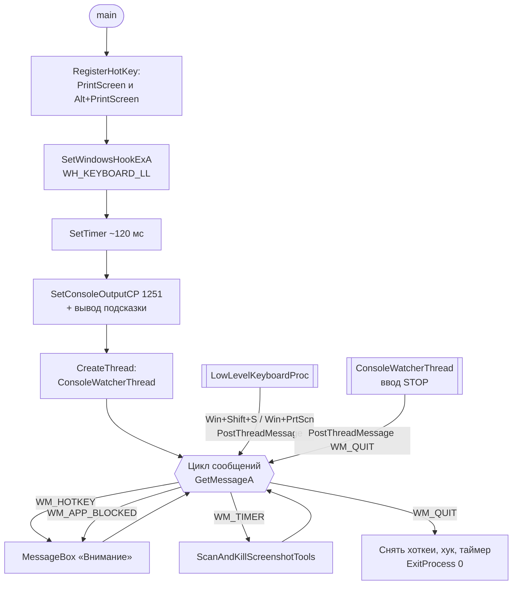

<div align="center">

[English](README.md) | **Русский**


# 🛡️ BlockScreenshot Win64

**Программа на ассемблере x64, которая блокирует создание скриншотов средствами Windows, пока работает**


-blueviolet)


</div>

---

## 📑 Содержание

- [Описание](#-описание)
- [Что блокируется](#-что-блокируется)
- [Платформа и технические требования](#-платформа-и-технические-требования)
- [Сборка и линковка (NASM + GoLink)](#-сборка-и-линковка-nasm--golink)
- [Запуск и завершение](#-запуск-и-завершение)
- [Как это работает](#-как-это-работает)
- [Настройка](#-настройка)
- [Ограничения](#-ограничения)
- [Возможные проблемы](#-возможные-проблемы)

---

## 📖 Описание

**BlockScreenshot Win64** — консольная утилита, написанная целиком на ассемблере (NASM, синтаксис Intel) для 64-разрядной Windows. Пока программа запущена, она перехватывает стандартные способы сделать снимок экрана и вместо этого показывает пользователю предупреждение.

Программа не использует C runtime и сторонние библиотеки: все возможности реализованы прямыми вызовами WinAPI из `kernel32.dll` и `user32.dll`. Права администратора и драйверы не нужны.

В основе защиты шесть слоёв: два механизма перехвата клавиш (горячие клавиши и низкоуровневый хук) плюс фоновое «добивание» программ для скриншотов, запущенных не клавишами.

---

## 🎯 Что блокируется

| # | Способ сделать скриншот | Чем перехватывается |
|:-:|---|---|
| 1 | `PrintScreen` | `RegisterHotKey` |
| 2 | `Alt` + `PrintScreen` | `RegisterHotKey` |
| 3 | `Win` + `Shift` + `S` (Ножницы) | низкоуровневый хук клавиатуры |
| 4 | `Win` + `PrintScreen` (сохранение в файл) | низкоуровневый хук клавиатуры |
| 5 | `Win` + `Alt` + `PrintScreen` | низкоуровневый хук клавиатуры (проверяется, что зажат `Win`) |
| 6 | «Ножницы» / Screen Sketch, запущенные **без клавиш** (значок, меню «Пуск» и т. д.) | опрос списка процессов каждые ~120 мс и `TerminateProcess` |

При срабатывании любого из слоёв показывается системное окно-предупреждение с заголовком «Внимание».

---

## 📂 Структура репозитория

```
BlockScreenshot/
├── BlockScreenshot_Win64.asm   # весь исходный код
└── README.md
```

---

## 💻 Платформа и технические требования

| Параметр | Значение |
|---|---|
| **ОС** | Windows 10 / 11, 64-bit |
| **Архитектура** | x86-64 |
| **Соглашение о вызовах** | Microsoft x64 ABI (`rcx`, `rdx`, `r8`, `r9` + 32 байта shadow space; стек выровнен по 16 байт) |
| **Тип приложения** | Консольное (`/console`) |
| **Ассемблер** | [NASM](https://www.nasm.us/) 2.15+ (формат `win64`) |
| **Линковщик** | [GoLink](http://www.godevtool.com/) |
| **Библиотеки** | `kernel32.dll`, `user32.dll` |
| **Права** | Обычный пользователь; администратор не требуется |

Используемые функции WinAPI:

| Назначение | Функции |
|---|---|
| Горячие клавиши | `RegisterHotKey`, `UnregisterHotKey` |
| Клавиатурный хук | `SetWindowsHookExA`, `CallNextHookEx`, `UnhookWindowsHookEx`, `GetAsyncKeyState` |
| Цикл сообщений и таймер | `GetMessageA`, `PostThreadMessageA`, `SetTimer`, `KillTimer`, `GetCurrentThreadId` |
| Процессы | `CreateToolhelp32Snapshot`, `Process32First`, `Process32Next`, `OpenProcess`, `TerminateProcess`, `CloseHandle` |
| Консоль и потоки | `GetStdHandle`, `ReadFile`, `WriteFile`, `SetConsoleOutputCP`, `CreateThread` |
| Прочее | `MessageBoxA`, `wsprintfA`, `lstrcmpiA`, `GetLastError`, `ExitProcess` |

---

## 🔧 Сборка и линковка (NASM + GoLink)

Убедитесь, что `nasm.exe` доступен из командной строки (добавлен в `PATH`), а `GoLink.exe` лежит в текущей папке или тоже в `PATH`.

**1. Ассемблирование**

```bat
nasm -f win64 BlockScreenshot_Win64.asm -o BlockScreenshot_Win64.obj
```

**2. Линковка**

```bat
GoLink.exe /console /entry main BlockScreenshot_Win64.obj kernel32.dll user32.dll
```

На выходе получится `BlockScreenshot_Win64.exe`.

| Ключ GoLink | Значение |
|---|---|
| `/console` | собрать консольное приложение |
| `/entry main` | точка входа — метка `main` |
| `kernel32.dll`, `user32.dll` | библиотеки, из которых импортируются функции WinAPI |

> ⚠️ **Не убирайте `/console`, если нужен штатный выход.** Без консоли нельзя будет ввести `STOP` (см. ниже), и завершить программу получится только через Диспетчер задач.

---

## ▶️ Запуск и завершение

### Запуск

Откройте командную строку (или PowerShell) и запустите:

```bat
BlockScreenshot_Win64.exe
```

В консоль будет выведена подсказка (на русском языке, в кодировке CP1251):

```
Для безопасного завершения программы введите STOP и нажмите Enter.
```

После этого окно консоли можно свернуть: программа продолжит работать в фоне, пока процесс жив.

### Безопасное завершение

Введите в окне программы `STOP` (регистр не важен: `stop`, `Stop`, `STOP`) и нажмите `Enter`. Программа снимет горячие клавиши, хук и таймер и завершится с кодом `0`.

> ℹ️ Если закрыть окно или нажать `Ctrl+C`, процесс просто будет остановлен. Windows сама освободит горячие клавиши и хук процесса, но штатный выход через `STOP` остаётся предпочтительным.

---

## ⚙️ Как это работает

### Общая схема



В программе два потока:

| Поток | Что делает |
|---|---|
| **Главный** | владеет горячими клавишами, хуком и таймером; крутит цикл сообщений и показывает предупреждения |
| **`ConsoleWatcherThread`** | в фоне читает консоль и ждёт слово `STOP` (чтение блокирующее, поэтому оно вынесено в отдельный поток) |

### Разбор по этапам

**1. Горячие клавиши.** `RegisterHotKey(NULL, …)` регистрирует `PrintScreen` и `Alt+PrintScreen` (с флагом `MOD_NOREPEAT`) для главного потока. Нажатие приходит как `WM_HOTKEY`, а сама клавиша до системы не доходит. Если регистрация не удалась, показывается отладочное окно `DEBUG` с кодом `GetLastError`, работа продолжается.

**2. Низкоуровневый хук (`LowLevelKeyboardProc`).** Хук `WH_KEYBOARD_LL` получает каждое нажатие клавиши в системе. Обрабатываются только `WM_KEYDOWN` и `WM_SYSKEYDOWN`:

- клавиша `S` и при этом зажаты `Win` (левая или правая) и `Shift` → блокировка;
- клавиша `PrintScreen` и при этом зажата `Win` (с `Alt` или без) → блокировка;
- всё остальное передаётся дальше через `CallNextHookEx`.

Состояние модификаторов проверяется через `GetAsyncKeyState`. При блокировке хук отправляет главному потоку сообщение `WM_APP_BLOCKED` (`0x8001`) и возвращает `1` без вызова `CallNextHookEx`, так что система комбинацию не получает.

**3. Опрос процессов (`ScanAndKillScreenshotTools`).** Таймер `SetTimer` каждые 120 мс присылает `WM_TIMER`. Обработчик делает снимок процессов (`CreateToolhelp32Snapshot`), обходит его через `Process32First` / `Process32Next` и сравнивает имя exe-файла (без учёта регистра, `lstrcmpiA`) со списком:

```
SnippingTool.exe
ScreenSketch.exe
ScreenClippingHost.exe
ScreenClipHost.exe
```

Если совпадение найдено, процесс открывается через `OpenProcess(PROCESS_TERMINATE)` и завершается через `TerminateProcess`, а главному потоку уходит `WM_APP_BLOCKED`.

**4. Предупреждение.** На `WM_HOTKEY` и `WM_APP_BLOCKED` главный поток показывает `MessageBoxA` с флагами `MB_ICONWARNING | MB_SYSTEMMODAL` (окно поверх остальных). Заголовок «Внимание»; текст по умолчанию в переводе: «Нет, не в мою смену. Закрой сайт *** и только тогда сможешь сделать скриншот. Голуби не знают пощады.»

**5. Кодировка.** Тексты заданы байтами CP1251, поэтому не зависят от кодировки самого `.asm`-файла. Чтобы подсказка в консоли отображалась корректно, на старте вызывается `SetConsoleOutputCP(1251)`.

**6. Завершение.** Получив `STOP`, поток-наблюдатель отправляет главному потоку `WM_QUIT`. `GetMessageA` возвращает `0`, и `main` переходит в ветку `.done`: `UnregisterHotKey` для обеих комбинаций, `UnhookWindowsHookEx`, `KillTimer`, `CloseHandle` для потока и `ExitProcess(0)`.

---

## 🛠 Настройка

| Что менять | Где | Описание |
|---|---|---|
| Текст предупреждения | `msgText` | Заменить `"***"` на название/адрес сайта или написать свой текст |
| Заголовок окна | `msgTitle` | Байты CP1251 |
| Интервал опроса процессов | `POLL_INTERVAL_MS` | Меньше значение — быстрее реакция, но выше нагрузка на CPU |
| Имена блокируемых процессов | `nameSnippingTool`, `nameScreenSketch`, `nameScreenClipHost1`, `nameScreenClipHost2` | Допишите/исправьте под свою версию Windows |
| Слово для выхода | `exitFlag` | Хранится в верхнем регистре, например `"STOP"` |

> 💡 **Как получить байты CP1251 для своего текста** (Python 3):
> ```bat
> python -c "print(','.join(hex(b) for b in 'Ваш текст'.encode('cp1251')))"
> ```
> Результат вставьте в `db`.

> 🔍 **Как узнать точное имя процесса.** Имя Snipping Tool / Screen Sketch зависит от версии и сборки Windows. Запустите «Ножницы» любым способом **без** этой программы, откройте Диспетчер задач → вкладка «Подробности» и впишите точное имя `.exe` в соответствующую переменную `nameXxx`.

---

## ⚠️ Ограничения

Это защита «на уровне пользовательского режима», а не гарантия невозможности скриншота.

- ❌ **Не блокируются** сторонние программы захвата экрана и запись видео.
- ❌ **Не блокируются** фото экрана на телефон и удалённый просмотр (RDP, TeamViewer и т. п.).
- ⏱ **Опрос процессов — это гонка.** Интервал ~120 мс можно уменьшить ценой нагрузки на CPU, но 100% гарантии «успеть раньше» без прав администратора или драйвера не даёт ни один метод.
- 🔎 **Имена процессов зависят от версии Windows.** Если в вашей сборке имя отличается, слой 6 работать не будет, пока вы не впишете правильное имя.
- 🔒 **Окна с повышенными правами.** Windows может не передавать клавиатурные события окнам, запущенным от администратора, процессу без таких прав. Для таких случаев запускайте программу с теми же правами.
- 🧱 Комбинации, не перечисленные в таблице выше (например, с `Ctrl`), явно не обрабатываются.

Проект подходит для демонстрации техник WinAPI и для простых сценариев вроде киоска или рабочей машины. Как средство защиты от целенаправленного копирования контента он не предназначен.

---

## 🩺 Возможные проблемы

| Симптом | Причина и решение |
|---|---|
| Окно `DEBUG`: `RegisterHotKey(PrintScreen) FAILED` | Клавиша уже занята. Отключите в настройках Windows пункт «Использовать кнопку Print Screen для запуска функции создания фрагмента экрана» (*Параметры → Специальные возможности → Клавиатура*) и перезапустите программу |
| Окно `DEBUG`: `SetWindowsHookExA ... FAILED` | Не удалось установить хук; смотрите код `GetLastError` в окне. Программа продолжит работу без слоёв 3–5 |
| Кракозябры в консоли | Шрифт консоли не поддерживает кириллицу. Выберите шрифт с её поддержкой (например, Consolas) |
| NASM ругается на первую строку файла | Пересохраните `.asm` как UTF-8 **без BOM** |
| GoLink сообщает о неразрешённом символе | Проверьте, что в командной строке указаны обе библиотеки: `kernel32.dll` и `user32.dll` |
| После выхода консоль осталась в CP1251 | Это ожидаемо: `SetConsoleOutputCP` меняет кодовую страницу консоли. Вернуть можно командой `chcp 866` (или `chcp 65001`) |

---

<div align="center">

Сделано на ассемблере с ❤️

</div>
